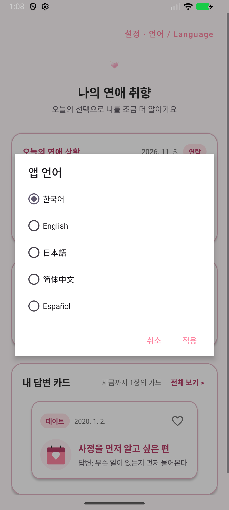
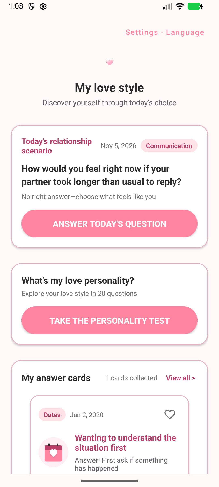
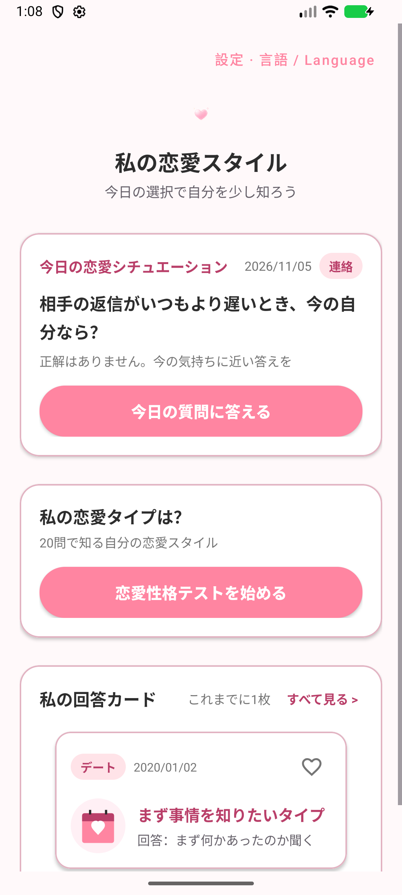
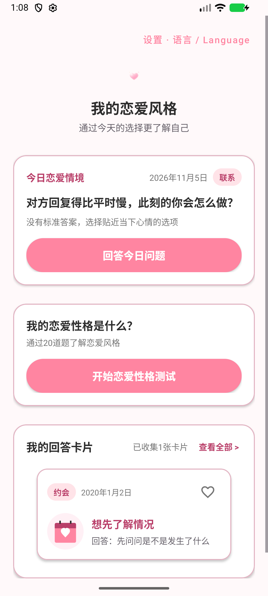
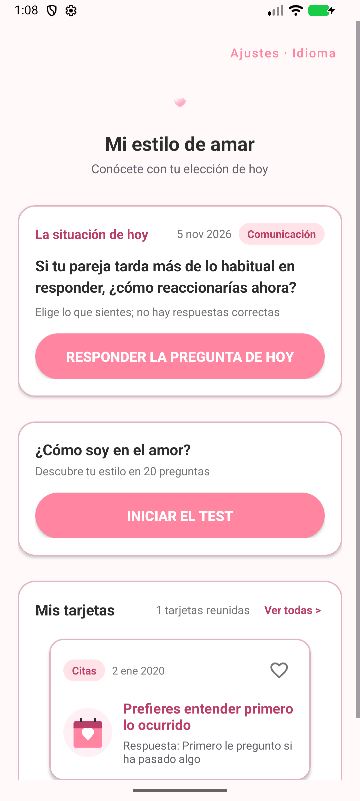
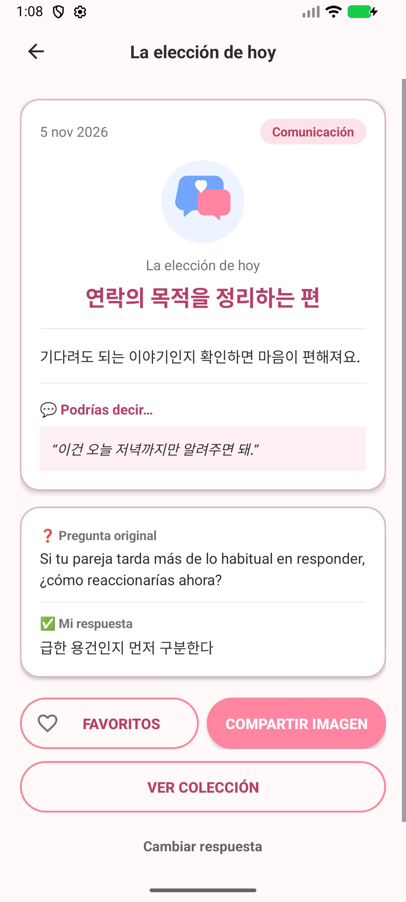
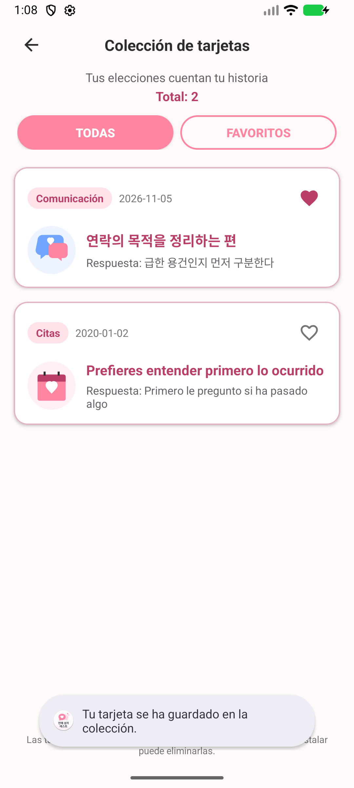
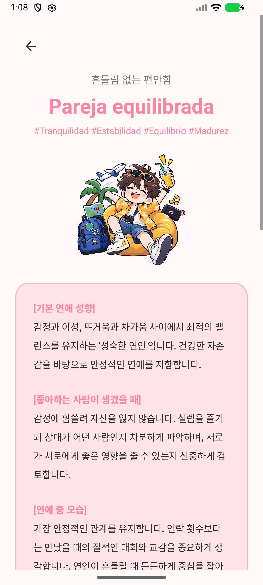

# 연애 성격 테스트 12.0 · 화면 기록

2026년 11월 6일에 정리한 화면과 [선별한 Android 코드 예제](source/)입니다. 11월 5일과 같은 버전의 소스로 촬영했습니다.

## 화면으로 보는 언어 설정

홈 오른쪽 위에서 언어를 고르고 **적용**을 누르면 앱이 선택값을 기기에 저장하고 화면을 다시 그립니다. 다음 실행에도 선택한 언어가 적용됩니다. 답변 카드는 원래 기록을 보존하고 화면에 표시할 때 앱에 포함된 번역 문구를 읽습니다. [설정 창](source/app/src/main/java/com/testapp/fifteenthapp_pshocology/LanguageSettingsDialog.kt)

번역표 856개 항목 중 각 외국어에서 630개는 한국어 원문과 같습니다. 아래 스페인어 결과 화면에서도 질문과 버튼은 스페인어이고 결과 제목·해석은 한국어로 표시됩니다.

**한국어 기본 설정**

**영어 홈**

**일본어 홈**

**중국어 간체 홈**

**스페인어 홈**

**오늘의 답변 결과**

**답변 카드 모음집**

**성격 테스트 결과**

[실행 검증](verification/README.md) · [공개용 소스 가공 내역](docs/EXPORT_NOTES.md)

