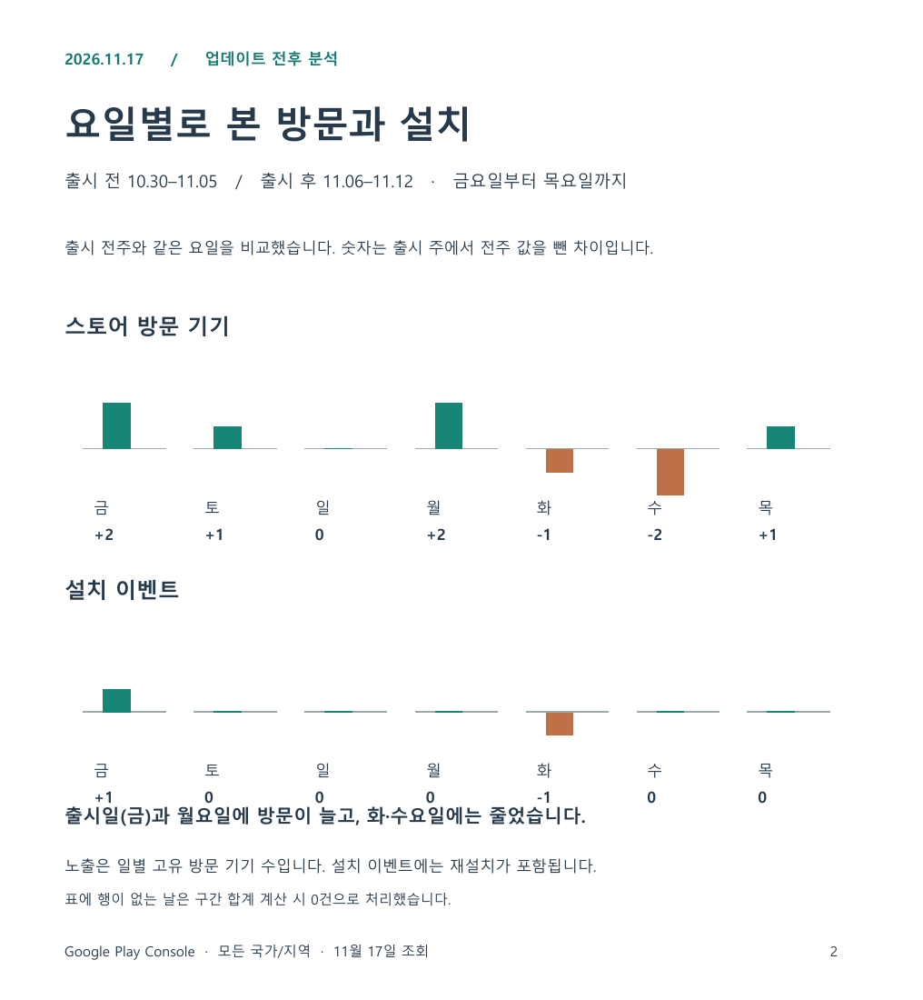
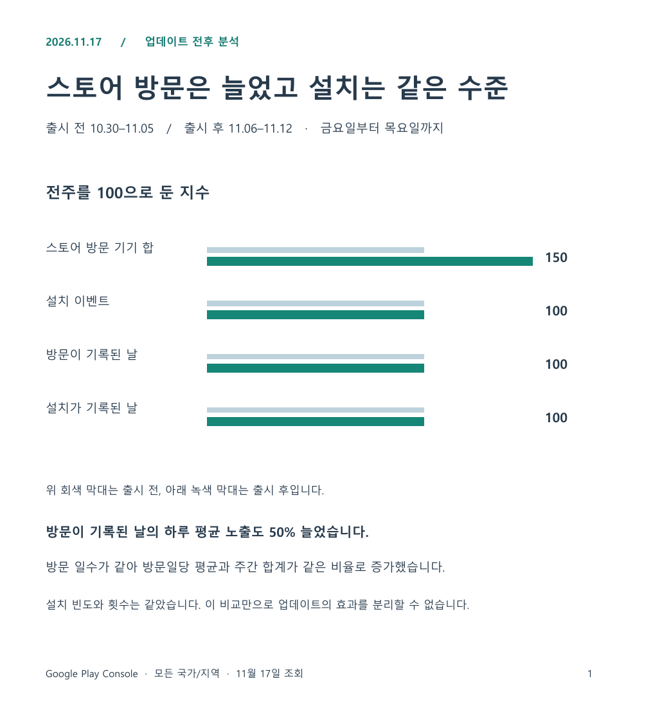

# 2026-11-17 · 업데이트하고 나서, 설치도 늘었을까?

가볍게 만든 앱인데도 다운로드가 조금씩 쌓였다. 그래서 이번에 언어 설정을 손보고 나서 제일 궁금했던 것도 그거였다. 업데이트하고 나면 스토어에 들어오는 사람도, 실제로 설치하는 사람도 조금 더 늘까?

11월 6일에 새 버전을 올렸다. 출시 직전 일주일(10월 30일~11월 5일)과 출시일부터 일주일(11월 6~12일)을 나란히 놓고 봤다. 금요일은 금요일끼리 비교하고 싶어서 양쪽 다 목요일까지 딱 7일씩 잡았다.

처음 눈에 들어온 건 **스토어 방문이 50% 늘었다**는 숫자였다. 요일별로 펼쳐 보니 매일 조금씩 늘어난 건 아니었다. 출시한 금요일과 그다음 월요일에 전주보다 더 많이 들어왔고, 오히려 화요일과 수요일에는 줄었다. 방문이 있었던 날의 수도 전주와 같았다.

그다음 설치 차트를 봤다. **설치 횟수도, 설치가 있었던 날 수도 전주와 같았다.** 누적 다운로드 그래프만 봤을 때는 업데이트 뒤에도 숫자가 올라가니까 반응이 좋아진 것처럼 느꼈다. 그런데 일주일씩 잘라 보니, 내가 궁금했던 건 ‘계속 설치하고 있나’보다 ‘예전보다 더 자주 설치하고 있나’에 가까웠다. 두 질문의 답이 다를 수 있다는 걸 이번에 체감했다.

| 지표 | 전주 대비 | 해석 |
|---|---:|---|
| 스토어 등록정보 방문 기기 합 | +50% | 상세 페이지를 방문한 기기의 일별 합계가 늘었습니다. |
| 방문이 발생한 날 | 0일 차이 | 방문이 발생한 날짜 수는 같았습니다. |
| 방문일당 평균 기기 | +50% | 방문이 있는 날의 방문 규모가 커졌습니다. |
| 하루 최다 방문 기기 | +100% | 가장 많이 방문한 날의 수치는 전주의 두 배였습니다. |
| 설치 이벤트 | 0% | 재설치를 포함한 주간 설치 횟수는 같았습니다. |
| 설치가 발생한 날 | 0일 차이 | 설치 빈도에도 변화가 없었습니다. |

이번 기록에는 ‘스토어에 들어온 기기는 늘었고, 첫 주 설치는 전주만큼 나왔다’까지 적어 두려고 한다. 워낙 건수가 적어서 몇 번의 방문으로도 퍼센트는 크게 움직인다. 다음에 숫자를 다시 볼 때는 50%라는 비율보다, 이번에 늘어난 방문이 그다음 주에도 이어졌는지부터 보고 싶다.

[공개 PDF 내려받기](comparison.pdf)
