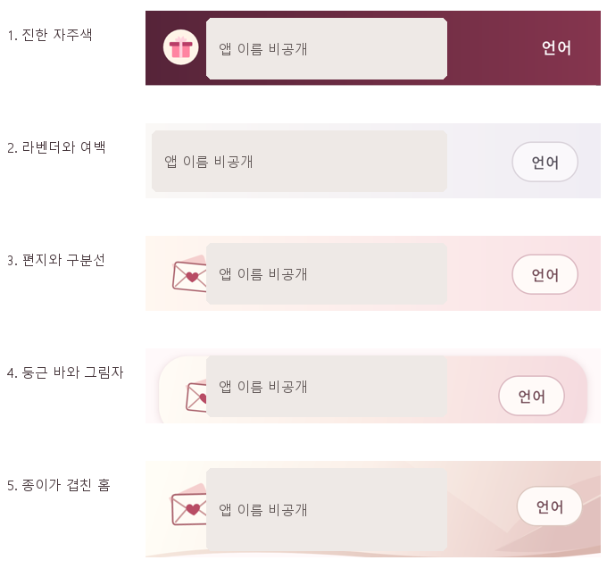

# 2026-11-17 · 업데이트하고 나서, 설치도 늘었을까?

가볍게 만든 앱인데도 다운로드가 조금씩 쌓였다. 그래서 이번에 언어 설정을 손보고 나서 제일 궁금했던 것도 그거였다. 업데이트하고 나면 스토어에 들어오는 사람도, 실제로 설치하는 사람도 조금 더 늘까?

11월 6일에 새 버전을 올렸다. 출시 직전 일주일(10월 30일~11월 5일)과 출시일부터 일주일(11월 6~12일)을 나란히 놓고 봤다. 금요일은 금요일끼리 비교하고 싶어서 양쪽 다 목요일까지 딱 7일씩 잡았다.

처음 눈에 들어온 건 **스토어 방문이 50% 늘었다**는 숫자였다. 요일별로 펼쳐 보니 매일 조금씩 늘어난 건 아니었다. 출시한 금요일과 그다음 월요일에 전주보다 더 많이 들어왔고, 오히려 화요일과 수요일에는 줄었다. 방문이 있었던 날의 수도 전주와 같았다.


그다음 설치 차트를 봤다. **설치 횟수도, 설치가 있었던 날 수도 전주와 같았다.** 누적 다운로드 그래프만 봤을 때는 업데이트 뒤에도 숫자가 올라가니까 반응이 좋아진 것처럼 느꼈다. 그런데 일주일씩 잘라 보니, 내가 궁금했던 건 ‘계속 설치하고 있나’보다 ‘예전보다 더 자주 설치하고 있나’에 가까웠다. 두 질문의 답이 다를 수 있다는 걸 이번에 체감했다.

| 지표 | 전주 대비 | 해석 |
|---|---:|---|
| 스토어 등록정보 방문 기기 합 | +50% | 상세 페이지를 방문한 기기의 일별 합계가 늘었습니다. |
| 방문이 발생한 날 | 0일 차이 | 방문이 발생한 날짜 수는 같았습니다. |
| 방문일당 평균 기기 | +50% | 방문이 있는 날의 방문 규모가 커졌습니다. |
| 하루 최다 방문 기기 | +100% | 가장 많이 방문한 날의 수치는 전주의 두 배였습니다. |
| 설치 이벤트 | 0% | 재설치를 포함한 주간 설치 횟수는 같았습니다. |
| 설치가 발생한 날 | 0일 차이 | 설치 빈도에도 변화가 없었습니다. |


이번 기록에는 ‘스토어에 들어온 기기는 늘었고, 첫 주 설치는 전주만큼 나왔다’까지 적어 두려고 한다. 워낙 건수가 적어서 몇 번의 방문으로도 퍼센트는 크게 움직인다. 다음에 숫자를 다시 볼 때는 50%라는 비율보다, 이번에 늘어난 방문이 그다음 주에도 이어졌는지부터 보고 싶다.

[공개 PDF 내려받기](comparison.pdf)


---

## 2026.11.17 · 설치한 다음, 첫 답을 고르고 결과를 읽기까지

오늘은 다운로드 그래프를 보고 나서 앱을 처음부터 다시 써봤다. 숫자로 볼 때는 한 번의 설치인데, 그 뒤에 있는 사람은 첫 화면에서 어디를 누를지 고르고 질문을 풀고 나서야 결과를 본다. 그 흐름을 직접 따라가 보니 이번 버전에서 먼저 손볼 부분이 보였다.

### 홈을 몇 번이나 다시 그린 이유

이 앱에서 제일 먼저 해봤으면 하는 건 원래 있던 성격 테스트다. 그런데 오늘의 질문과 모아둔 카드까지 한 화면에 놓으니 세 가지가 비슷한 비중으로 보였다. 테스트를 맨 위로 올리고, 오늘의 질문과 모음집 사이에는 한 박자 쉬어 갈 만큼 여백을 뒀다. 아래로 내려가도 앱 이름과 언어 설정은 같은 자리에 남는다.

헤더는 생각보다 여러 번 바꿨다. 진한 색을 넣으니 상단만 눈에 들어왔고, 채도를 낮추니 이번엔 분홍색 카드들이랑 따로 노는 느낌이었다. 결국 내가 처음부터 좋아했던 카드 테두리는 되살렸다. 홈 상단은 편지지 두 장이 겹친 것처럼 아래 곡선을 조금 어긋나게 놓고, 봉투 한쪽이 접힌 듯한 음영을 더했다. 마지막 수정은 홈에만 적용했다. 질문을 풀러 들어가면 익숙한 자리에 뒤로가기와 제목이 보인다.

### 결과를 읽고 실제로 한마디 해볼 수 있게

약속 당일에 상대가 혼자 쉬고 싶다고 할 때, 서운하다는 답을 골라봤다. 그때 궁금한 건 내가 무슨 유형인지도 있지만, 상대를 쉬게 해주고 싶은 마음과 내 시간도 존중받고 싶은 마음을 어떻게 같이 전할지였다. 그래서 선택한 답의 짧은 해석 뒤에 그 질문에서 생각해 볼 상황을 덧붙였다. 30개 질문에 각각 해설을 썼고, 선택지마다 달랐던 120개의 결과도 살렸다.

대화 예시는 따로 빼서 평소 문자처럼 편하게 읽히게 했다. 아래로 내려가면 원래 질문과 내가 고른 답을 다시 확인할 수 있다. 나중에 모음집에서 열어도 왜 그 답을 골랐는지 떠올릴 만한 카드가 됐으면 했다.

### 언어를 바꾼 뒤, 마지막 문장까지 따라가 봤다

스페인어로 질문을 풀었는데 막상 결과에서 한국어가 나왔다. 설정 화면만 번역된 걸 보고 끝냈으면 지나쳤을 부분이다. 한국어를 기본으로 두고, 영어·일본어·중국어·스페인어의 질문, 선택지, 결과 제목, 해석, 대화 예시를 앱 안에 담았다. 언어를 바꿀 때 별도로 번역을 내려받을 필요도 없다. 이번에는 외국어 문구에 한국어가 남았는지 검사하고 기기에서도 결과를 열어 봤다. 번역은 일부 표현을 직접 다듬었고, 네 언어 전체의 자연스러움까지 원어민 검수를 마친 단계는 아니다.

### 빠르게 두 번 누르고, 출시 화면까지

질문을 풀다가 답을 연달아 눌렀을 때도 확인했다. 첫 답을 고르는 순간 그 문항의 선택지를 잠그고, 바로 다른 답을 눌러도 한 번만 채점되게 했다. 테스트에서도 일부러 두 답을 잇달아 눌러 다음 화면이 정확히 두 번째 문항인지 확인했다. 언어를 바꾼 뒤 화면을 다시 열거나, 저장한 카드를 모음집에서 꺼내는 흐름도 에뮬레이터에서 점검했다.

마지막으로 버전을 12.0에서 13.0으로 올렸다. 테스트를 실행하고 배포용 파일을 만든 뒤 기존 업로드 키로 서명해 서명을 확인했다. Play Console에 올려 버전 번호를 다시 보고, 사용자에게 보일 한국어 업데이트 안내를 적었다. 게시 개요에서 이번에 올리는 항목이 프로덕션 전체 출시 한 건인 것까지 확인했다.

11월 17일 기록 시점에는 13.0이 ‘검토 중인 변경사항’에 들어갔다. 여기까지가 오늘 확인한 심사 제출 단계다. 다음에 숫자를 볼 때는 다운로드와 함께, 테스트를 끝낸 사람이 오늘의 질문이나 저장한 카드를 다시 보러 오는지도 궁금하다.

---

## 코드와 시안으로 다시 보는 13.0 작업일지

### 1. 답을 한 번 골랐는데 두 문항이 넘어갈 수 있었다

처음 의심한 건 점수 계산식이었다. 코드를 따라가 보니 타이밍이 먼저 눈에 들어왔다. MainActivity.kt에서 답을 누르면 그 자리에서 점수와 문항 번호를 올리는데, 다음 질문은 버튼이 흐려지는 애니메이션을 0.1초 보여준 뒤에 그린다. 숫자는 이미 다음 문항을 가리키는데 화면에는 이전 버튼이 남아 있는 셈이었다. 수정 전 기기에서 실제 건너뜀을 관찰한 건 아니고, 코드를 읽다가 발견한 틈이다.

수정 전 흐름을 줄여 쓰면 이렇다.
> 점수 1점 추가 → 문항 번호 1 증가 → 100ms 뒤 다음 문항 표시

그래서 애니메이션은 살리고 채점 직전에 두 가지를 확인했다. 버튼을 만들 때 어느 문항인지 기억해 두고, 누르는 순간에도 같은 화면과 같은 문항인지 본다. 맞으면 모든 선택지를 먼저 잠근 다음 점수를 올린다. 한 버튼만 잠그면 바로 옆 답을 누르는 경우가 남는다.

```kotlin
val displayedQuestionIndex = currentQuestionIndex
```

```kotlin
if (currentScreen != ScreenState.TEST_QUESTION ||
    currentQuestionIndex != displayedQuestionIndex) return@setOnClickListener
for (i in 0 until answerContainer.childCount)
    answerContainer.getChildAt(i).isEnabled = false
```

검사도 손가락 속도에 맡기지 않았다. 테스트 코드가 첫 번째와 두 번째 답을 한 화면에서 연달아 누르게 했다. 두 번째 버튼이 잠겼는지 보고, 화면을 다시 만들고 나서도 진행 표시가 정확히 2번인지 확인했다.

### 2. 스페인어로 풀었는데 결과를 읽을 수 없었다

질문만 보고 번역이 됐다고 생각하기 쉬웠다. 그런데 답을 고르고 나니 결과 제목도, 해석도, 대화 예시도 한국어였다. 영어 번역표를 확인했을 때도 기존 856개 항목 중 630개가 한국어 원문과 같았다. 언어 선택 버튼을 손봐서는 이 문제가 해결되지 않았다.

ui_translations.json에서 질문과 선택지 다음에 나오는 문구까지 채웠다. 결과를 열 때는 저장된 카드를 읽고 현재 언어로 표시할 사본을 만든다. 한국어로 답하고 나중에 스페인어로 카드를 다시 열어도 내가 골랐던 답과 기록 날짜는 그대로다. 첫 실행 언어는 한국어로 두고 네 외국어 문구는 앱에 넣었다.

```kotlin
val record = rawRecord.localized()
```

해설도 길이만 늘리면 읽을 이유가 없었다. 약속이 당일 취소된 질문이라면 ‘상대가 쉬었으면 하는 마음’과 ‘내가 비워 둔 시간’이 동시에 있다는 얘기를 담았다. 반면 비 때문에 데이트가 틀어진 질문에서는 아쉬운 게 장소인지, 거기서 하고 싶었던 일인지 짚어 보게 했다. DailyReflection.kt에 이런 상황 해설 30개를 두고, 결과 화면에서는 내가 고른 답의 해석 뒤에 해당 질문의 해설을 한 단락 띄워 붙였다.

```kotlin
val reflection = dailyReflectionByPrompt[rawRecord.questionSnapshot.prompt]
```

번역된 질문 문장을 검색 키로 쓰면 언어가 바뀔 때 해설을 놓칠 수 있다. 그래서 원래 저장한 질문으로 해설을 찾고 표시할 때 번역했다. 번역표의 빈 값과 한국어 잔여 문구도 검사했다. 이 검사로 어색한 외국어 표현까지 잡을 수는 없다. 기계 번역 후 일부를 다듬었고 전체 원어민 감수는 남았다.

### 3. 화면에서 제일 중요한 게 뭔지 자꾸 놓쳤다

처음 요청은 단순했다. “메인 기능이니까 맨 위에 두고.” activity_main.xml에서 테스트 카드를 오늘의 질문 앞으로 옮기고, 홈 헤더는 스크롤 영역 밖으로 꺼냈다. 오늘의 선택 화면도 함께 봤다. 대화 예시는 작은 기울임꼴이라 눈에 잘 안 들어왔고, 아래쪽에서는 질문 설명과 답이 붙어 보였다. 예문을 따로 읽을 수 있도록 둥근 배경에 일반 서체를 쓰고, 원래 질문과 고른 답 사이 여백을 늘렸다.

첫 시안에서는 진한 자주색 그라데이션 위에 흰 글씨를 얹었다. 그런데 앱을 열자마자 ‘나의 연애 취향’이 보였다. 기존 소개 문구 리소스를 헤더 제목에도 썼기 때문이다. 제목 참조를 loc_001에서 app_name으로 고쳐 앱의 실제 이름이 각 언어에 맞게 나오도록 했다. 색도 너무 진해서 아래의 가벼운 분홍색 카드보다 헤더가 더 무거워 보였다.

두 번째는 정반대로 갔다. 연한 라벤더 바에 제목과 언어 버튼만 두고, 첫 카드의 버튼과 테두리까지 보랏빛으로 맞췄다. 홈 세 영역 사이도 더 띄웠다. 여백은 마음에 들었지만 상단은 글씨만 남아 밋밋했고, 이미 좋아했던 첫 카드까지 달라졌다. 여기서 요구가 분명해졌다. “지금 또 왜 색상이랑 테두리 바꾼 거야.” 다음 수정에서는 카드 사이 간격을 살리고 세 카드의 분홍 테두리와 그림자를 복원했다.

### 4. 선을 지우고, 그림자를 줬다가, 종이를 겹쳤다

세 번째 시안에는 하트로 봉한 편지를 그려 넣었다. 홈에는 편지 전체를, 내부 화면에는 작은 봉인 문양과 뒤로가기를 뒀다. 크림색과 장밋빛이 카드와 이어졌지만, 헤더 끝에 그은 1dp 선이 화면을 반듯하게 잘라 놓은 듯했다. 색을 맞춘 다음에도 평평해 보인 이유였다.

네 번째에는 그 선을 빼고 좌우 여백과 둥근 모서리를 줬다. 홈에는 4dp, 안쪽에는 2dp 그림자를 넣었다. 떠 있는 입체감은 생겼지만 화면마다 둥근 바가 하나씩 더 얹힌 모양이 됐다. 무엇보다 “홈만 바꾸라는 거야”라는 범위를 넘겼다. 내부 공통 스타일에 추가했던 바깥 여백과 그림자를 되돌리고, 작은 봉인과 뒤로가기가 있던 헤더를 복원했다.

마지막 시안에서는 홈 전용 home_brand.xml을 다시 그렸다. 둥근 사각형에 그림자를 주던 자리에 벡터 경로를 겹쳤다. 아래 종이는 조금 더 내려오고 위 종이는 먼저 휘어 들어간다. 그 사이로 보이는 로즈빛 가장자리가 종이 두께가 되고, 오른쪽의 작은 대각 면이 접힌 봉투처럼 보인다. 고정 영역의 최소 높이는 72dp에서 94dp로 늘려 제목과 접힌 면이 겹치지 않게 했다.

> 최종 홈 배경의 겹치는 순서 · 아래 종이 → 밝은 윗장 → 접힌 면 → 얇은 하이라이트

마지막으로 홈을 아래까지 스크롤해 봤다. 위에는 편지지 헤더가 남고 아래에는 원래의 분홍색 카드 모음집이 올라왔다. 이번 작업에서 가장 오래 걸린 건 색 하나 고르는 일보다, 마음에 들었던 부분까지 같이 바꿨다가 다시 제자리를 찾는 일이었다.



### 5. 빌드가 됐다는 말과 심사에 들어갔다는 말 사이

화면을 옮기는 과정에서 결과 화면의 ScrollView와 LinearLayout 닫는 태그 순서가 어긋났다. 첫 빌드는 XML을 읽는 단계에서 멈췄고, 한 번 고친 뒤에도 같은 오류가 났다. 결과 본문 중간에 먼저 닫힌 태그를 찾아 스크롤 영역 밖에서 헤더와 본문을 감싸도록 바로잡고 다시 빌드했다.

화면 검사도 처음부터 순탄하지 않았다. 에뮬레이터가 메모리 압박으로 앱 검사를 끝내지 못했다. 테스트 앱을 다시 설치하고 통합 검사 세 개를 실행해 통과한 뒤 홈, 결과, 모음집을 직접 캡처했다. 마지막 홈 전용 수정 후에도 디버그 빌드를 만들고 화면 전환 검사를 다시 돌렸다.

배포 때는 버전 코드와 표시 버전을 12에서 13, 12.0에서 13.0으로 올렸다. 처음 지정한 testReleaseUnitTest 작업이 프로젝트에 없어 명령이 중단됐다. 등록된 testDebugUnitTest와 bundleRelease를 실행해 테스트와 출시 번들 생성을 마쳤다. 기존 업로드 키로 번들에 서명한 다음 서명이 실제로 검증되는지도 확인했다.

Play Console에서 업로드된 번들이 13 (13.0)인지 보고 한국어 출시 노트를 적었다. 가독화 파일이 없다는 경고가 한 건 있었고 출시 저장은 가능했다. 저장 직후에는 아직 제출 전이었다. 자동 검사 중에는 제출 버튼도 비활성 상태였다. 이후 게시 개요에서 13.0 전체 출시가 ‘검토 중인 변경사항’ 아래로 들어간 것까지 확인했다. 11월 17일 이 기록의 마지막 장면은 심사 접수다. 스토어 배포 완료 시점은 이때 확인되지 않았다.
